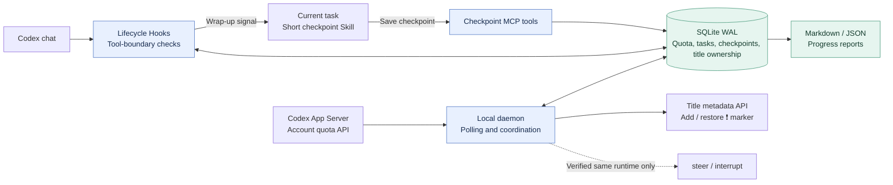

# fly-CodexLimit

[简体中文](README.md) | **English**

**Save your progress before Codex runs out of quota automatically. Resume from a checkpoint when you are ready.**

Python 3.11+ · Windows first · Standard-library runtime · [MIT](LICENSE)

fly-CodexLimit is a local quota guard for Codex. One daemon monitors account limits across
your tasks, asks running tasks to wrap up before quota is exhausted, and keeps durable
checkpoints. Confirmed pauses receive a `❗ ` title marker; the marker is removed after
you resume and the task actually executes work.

Polling, title metadata updates, and state coordination make **no model requests**.
Writing a semantic progress summary still uses the current task's model context.

> **Current scope:** cooperative protection through Codex Hooks. Force interruption requires
> a connection to the same runtime that owns the active turn. A separate App Server cannot
> take over an existing desktop turn. Desktop UI refresh after an external title update
> remains unverified. See the [compatibility record](docs/COMPATIBILITY.md) (Chinese).

## What it does

- **One account view:** checks short and long quota windows across relevant limit buckets.
- **Predictable thresholds:** 5% remaining for five-hour limits and 2% for weekly limits; adaptive reserves are opt-in.
- **Persistent checkpoints:** stores completed work, the current state, pending work, validation, and the next step.
- **Cheap title markers:** updates metadata directly and tracks ownership to preserve user edits.
- **Explicit resumption:** waits for fresh quota data and a user request, then staggers resume admission.
- **Reversible setup:** merges existing Hooks and MCP configuration, with backups and interrupted-install recovery.

## Architecture



16:9 exports: [PNG, 1920 × 1080](docs/images/architecture.en.png) · [Editable SVG](docs/images/architecture.en.svg).

Hooks read the local database instead of querying the account for every tool call.
During protection, new business operations are denied while the dedicated checkpoint
MCP tools remain available. The task saves a concise report and ends its current turn.

## Try the offline demo

```powershell
git clone https://github.com/flyl1u/fly-CodexLimit.git
cd fly-CodexLimit
python guard.py demo
```

The demo runs three simulated tasks through protection, checkpointing, title marking,
quota recovery, and user-initiated resumption. It makes **zero Codex connections and
zero model requests**. Each run uses isolated state; the trace is written to
`.guard-local/demo/demo-run.json`.

## Install on Windows

Requirements: **Python 3.11+**, a working **Codex CLI**, and an account signed in with
`codex login`. No third-party Python packages are required to run the project.

Install the integration, then explicitly enable and start monitoring:

```powershell
python guard.py doctor --live
python guard.py init
python guard.py install --dry-run
python guard.py install
powershell.exe -NoProfile -File .\scripts\start-guard.ps1
python guard.py status
```

The installer adds user-level Hooks, the `codex_limit_guard` MCP server, the
`codex-limit-checkpoint` Skill, and a removable block in global `AGENTS.md`.
The block asks agents to check local quota at each user turn, before writes, and
after about 60 seconds of work, even if a Hook signal is missing. Normal checks stay quiet.
It preserves unrelated configuration.

**Review and trust the Hook definitions in Codex**, using the startup review screen
or `/hooks` in the CLI. Codex skips untrusted Hooks; installing files alone does not
activate them. Fully quit and reopen Codex after this upgrade: existing desktop
chats can retain disabled Hook state. Checking a separate CLI does not refresh them.
See the [official Hook trust documentation](https://learn.chatgpt.com/docs/hooks#review-and-trust-hooks).

While the target chat is working, verify actual callbacks from another terminal:

```powershell
python guard.py status --thread YOUR_THREAD_ID --require-verified --json
```

Only fresh quota evidence can pause a chat. Missing, stale or incomplete quota,
monitor failure, MCP unavailability and Hook check errors leave normal chat running.
The status stays `unknown`; it is never reported as healthy monitoring. MCP startup
and user prompts can recover a missing monitor in the background, with concurrent
starts deduplicated. Explicit stop and uninstall prevent this recovery.

Exit 0 requires fresh prompt and pre-tool callbacks for the current turn; exit 2
means unverified. Registration, old callbacks and MCP checkpoints are not proof.
`health.connected` describes the account connection; `protection` reports callback
coverage of registered tasks separately. The global instruction block is a
cooperative fallback for missing Hooks, not a guarantee that the model follows it.
The independent server cannot hot-reload or forcibly interrupt desktop turns.

To start automatically at sign-in:

```powershell
powershell.exe -NoProfile -File .\scripts\install-startup.ps1
```

This creates a current-user Windows scheduled task that runs Python's `pythonw.exe`
directly, without a hidden PowerShell wrapper or an encoded command. The Python
installation must include `pythonw.exe`, and the project directory must stay in place.

Default state directory: `%USERPROFILE%\.codex\limit-guard`.
`CODEX_HOME`, `CODEX_LIMIT_GUARD_HOME`, and an explicit `--home PATH` are supported.
Put `--home` **before** the subcommand. For a custom Codex configuration directory,
use `install --codex-home PATH`; monitoring binds to that installation's account configuration.

## Daily use

```powershell
python guard.py status --json
python guard.py checkpoint --thread YOUR_THREAD_ID
python guard.py doctor --live --thread YOUR_THREAD_ID
```

Normal Hooks are quiet. The task is asked to save a checkpoint when a protection
threshold is reached. During protection, user messages still reach the task along with the complete
`codex-limit-checkpoint` Skill. Business tools pause while checkpoint MCP tools remain
available. If no fresh checkpoint exists at Stop, the Hook allows one bounded wrap-up
continuation before closing the turn. The state transitions are:

| Phase | Meaning |
| --- | --- |
| `running` | Work is in progress; milestone checkpoints can be saved. |
| `pausing` | Protection was requested; the turn has not yet been confirmed stopped. |
| `paused` | The turn ended; the daemon can mark its title and wait for quota recovery. |
| `ready` | A fresh query confirms quota recovery; the title marker remains. |
| `resuming` | A user request was admitted; the first business tool has not yet executed. |
| `running` / `idle` | Actual work resumed and the owned marker can be removed; `idle` means the turn ended. |

`idle` does not claim the whole task is complete. The guard never automatically replays
user messages or starts business turns in the background. Simultaneous resume requests
admit business execution in order with a spacing interval. Queued messages still reach
the task, which explains the wait; send another request later to continue. A new user turn
after recovery can also recover a task with a missing closing Hook. A reply without an
executed business tool keeps the pause marker.

Reports are exported as Markdown and JSON under the state directory's `checkpoints/`.
Filenames use a hash of the chat ID; the JSON includes the original ID. If wrap-up could
not save a fresh checkpoint, the report preserves the previous timestamp and says so.
Without a semantic checkpoint, it does not infer business progress from tool events.

## Configuration

`init` creates `config.json` in the state directory. See the [complete example](examples/config.json)
and [checkpoint example](examples/checkpoint.json). Restart the daemon after changes;
Hooks read configuration on their next invocation.

| Setting | Default | Purpose |
| --- | --- | --- |
| `pause_remaining` | `2` | Base remaining-percent wrap-up threshold for weekly and other windows. |
| `five_hour_pause_remaining` | `5` | Base remaining-percent wrap-up threshold for a 5-hour window, when present. |
| `resume_remaining` | `25` | Recovery hysteresis to avoid repeated pause/resume cycles. |
| `adaptive_reserve` | `false` | Explicitly enable thresholds based on concurrency and usage growth. |
| `reserve_per_extra_task` | `2` | Reserve per extra active task when adaptive reserves are enabled. |
| `max_pause_remaining` | `60` | Upper bound on the dynamic protection threshold. |
| `poll_seconds` | `30` | Account polling interval shared by all Hooks. |
| `grace_seconds` | `90` | Wait before the verified-runtime interrupt fallback. |
| `stale_seconds` | `120` | Maximum cache age; unknown quota does not pause normal work. |
| `resume_spacing_seconds` | `15` | Minimum spacing between resume admissions. |
| `resume_slot_seconds` | `120` | Queue and initial-execution slot validity. |
| `limit_ids` | `[]` | Inspect all returned buckets by default, or explicitly select relevant ones. |
| `control_active_turns` | `false` | Enable only with a connection to the same active runtime. |

The default base protection thresholds are **2% remaining for the weekly window** and
**5% remaining for a 5-hour window**, when present. Accounts without a 5-hour window use
the weekly 2% threshold. Windows are identified by their reported duration, rather than
assuming `primary` always means 5 hours; missing duration uses the 2% fallback.

Each window is checked against its own threshold, and any breached window triggers
protection. By default the thresholds stay at 5% / 2%, regardless of concurrent tasks or
usage growth. With `adaptive_reserve=true`, the dynamic reserve adds concurrent-task
reserve and that window's recent usage growth over the polling and wrap-up interval,
capped at `max_pause_remaining`.
Usage growth is measured between consecutive samples and never carried across a reset
or a window-duration change. Policy changes re-evaluate fresh quota without inheriting
an old threshold's protection latch; a cache outage does not create a recovery latch.
Recovery requires every relevant window to clear its
recovery line; a reset timestamp alone is not evidence of recovery.
These thresholds are estimates and cannot guarantee enough quota for every wrap-up.

`server_command` defaults to `["codex", "app-server"]`. On Windows, the npm shim is
resolved to its Node entry point without composing a shell command. A supported proxy
can be configured as an argument array. Even with active control enabled, the guard
checks the loaded thread, active status, and exact turn ID before steering or interrupting.

## Stop or uninstall

```powershell
python guard.py stop
powershell.exe -NoProfile -File .\scripts\install-startup.ps1 -Remove
python guard.py uninstall
```

Only matching, installer-owned configuration is removed. Other Hooks, MCP servers, and
manually edited Skills are preserved. Checkpoints, SQLite state, and original configuration
backups remain local. If a managed block was edited, the installer reports the conflict
and leaves it intact instead of overwriting current settings with an old backup.

`stop` is persistent and works even with invalid configuration or a broken database.
The chat's `disable_guard` MCP tool remains available during low-quota protection.
Cached Hooks become inert after uninstall. Resuming protection requires an explicit
`python guard.py enable` or `start-guard.ps1`; reinstalling alone does not enable it.
The logon task retries failures and has a one-minute recovery trigger, respecting stop.

For foreground debugging, use `python guard.py daemon`. `daemon --once` is a one-shot
diagnostic and does not provide continuous protection.

## Verification and limitations

```powershell
python -W error::ResourceWarning -m unittest discover -v
python -m compileall -q codex_limit_guard guard.py
python -m pip wheel . --no-deps --wheel-dir .guard-local/dist
```

The 88 tests cover quota windows, hysteresis, concurrent writes, schema upgrades, resume
admission, Hook decisions, native Windows launch commands, MCP, title ownership,
RPC timeout/disconnection, and reversible installation. Windows account reads, daemon
startup/shutdown, and isolated wheel installation have also been verified.

- Only sessions that load the trusted Hooks participate in protection.
- Hooks do not cover every model action, and already running commands may keep running.
- Forced control of an existing desktop turn requires a supported shared-runtime connection.
- External title writes and desktop title refresh are different behaviors; UI refresh is unverified.
- Other operating systems do not yet have verified startup integration.

Implementation details are in the [architecture notes](docs/ARCHITECTURE.md) and
[implementation plan](PLAN.md) (Chinese).

## License

[MIT](LICENSE). Copyright attribution is preserved in the license file.
