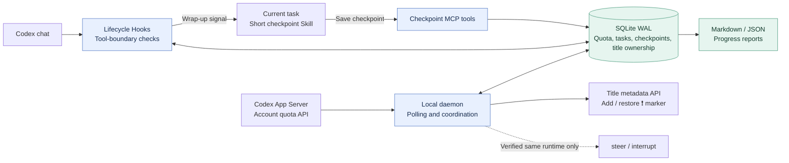

# fly-CodexLimit

**English** | [简体中文](README.zh-CN.md)

**Save your progress before Codex runs out of quota. Resume from a checkpoint when you are ready.**

Python 3.11+ · Windows first · Standard-library runtime · [MIT](LICENSE)

fly-CodexLimit is a local quota guard for Codex. One daemon monitors account limits across
your tasks, asks running tasks to wrap up before quota is exhausted, and keeps durable
checkpoints. Confirmed pauses receive a `❗ ` title marker; the marker is removed after
you resume and the task actually executes work.

Polling, title metadata updates, and state coordination make **no model requests**.
Writing a semantic progress summary still uses the current task's model context.

> **Current scope:** cooperative protection through Codex Hooks. Force interruption requires
> a connection to the same runtime that owns the active turn. A separate App Server cannot
> take over an existing desktop turn. Desktop UI refresh after an external title update
> remains unverified. See the [compatibility record](docs/COMPATIBILITY.md) (Chinese).

## What it does

- **One account view:** checks short and long quota windows across relevant limit buckets.
- **Earlier wrap-up for concurrent work:** reserves extra budget for additional tasks and recent usage growth.
- **Persistent checkpoints:** stores completed work, the current state, pending work, validation, and the next step.
- **Cheap title markers:** updates metadata directly and tracks ownership to preserve user edits.
- **Explicit resumption:** waits for fresh quota data and a user request, then staggers resume admission.
- **Reversible setup:** merges existing Hooks and MCP configuration, with backups and interrupted-install recovery.

## Architecture



Hooks read the local database instead of querying the account for every tool call.
During protection, new business operations are denied while the dedicated checkpoint
MCP tools remain available. The task saves a concise report and ends its current turn.

## Try the offline demo

```powershell
git clone https://github.com/flyl1u/fly-CodexLimit.git
cd fly-CodexLimit
python guard.py demo
```

The demo runs three simulated tasks through protection, checkpointing, title marking,
quota recovery, and user-initiated resumption. It makes **zero Codex connections and
zero model requests**. Each run uses isolated state; the trace is written to
`.guard-local/demo/demo-run.json`.

## Install on Windows

Requirements: **Python 3.11+**, a working **Codex CLI**, and an account signed in with
`codex login`. No third-party Python packages are required to run the project.

Start monitoring before installing the session integration:

```powershell
python guard.py doctor --live
python guard.py init
powershell.exe -NoProfile -File .\scripts\start-guard.ps1
python guard.py status
python guard.py install --dry-run
python guard.py install
```

The installer adds user-level Hooks, the `codex_limit_guard` MCP server, and the
`codex-limit-checkpoint` Skill. It preserves unrelated configuration.

**Review and trust the Hook definitions in Codex**, using the startup review screen
or `/hooks` in the CLI. Codex skips untrusted Hooks; installing files alone does not
activate them. Reopen the target chats so the updated configuration can load.
See the [official Hook trust documentation](https://learn.chatgpt.com/docs/hooks#review-and-trust-hooks).

To start automatically at sign-in:

```powershell
powershell.exe -NoProfile -File .\scripts\install-startup.ps1
```

This creates a current-user Windows scheduled task with a hidden window. The project
directory must remain available at its installed location.

Default state directory: `%USERPROFILE%\.codex\limit-guard`.
`CODEX_HOME`, `CODEX_LIMIT_GUARD_HOME`, and an explicit `--home PATH` are supported.
Put `--home` **before** the subcommand. For a custom Codex configuration directory,
use `install --codex-home PATH`; monitoring binds to that installation's account configuration.

## Daily use

```powershell
python guard.py status --json
python guard.py checkpoint --thread YOUR_THREAD_ID
python guard.py doctor --live --thread YOUR_THREAD_ID
```

Normal Hooks are quiet. At meaningful milestones, the task uses `save_checkpoint` to
record progress. The state transitions are:

| Phase | Meaning |
| --- | --- |
| `running` | Work is in progress; milestone checkpoints can be saved. |
| `pausing` | Protection was requested; the turn has not yet been confirmed stopped. |
| `paused` | The turn ended; the daemon can mark its title and wait for quota recovery. |
| `ready` | A fresh query confirms quota recovery; the title marker remains. |
| `resuming` | A user request was admitted; the first business tool has not yet executed. |
| `running` / `idle` | Actual work resumed and the owned marker can be removed; `idle` means the turn ended. |

`idle` does not claim the whole task is complete. The guard never automatically replays
user messages or starts a model turn. Simultaneous resume requests are admitted in order
with a spacing interval; a blocked message must be sent again later. A reply without an
executed business tool keeps the pause marker.

Reports are exported as Markdown and JSON under the state directory's `checkpoints/`.
Filenames use a hash of the chat ID; the JSON includes the original ID. If wrap-up could
not save a fresh checkpoint, the report preserves the previous timestamp and says so.
Without a semantic checkpoint, it does not infer business progress from tool events.

## Configuration

`init` creates `config.json` in the state directory. See the [complete example](examples/config.json)
and [checkpoint example](examples/checkpoint.json). Restart the daemon after changes;
Hooks read configuration on their next invocation.

| Setting | Default | Purpose |
| --- | --- | --- |
| `warn_remaining` | `20` | Remaining-percent warning line; defer new rounds and parallel branches. |
| `pause_remaining` | `10` | Base wrap-up reserve. |
| `resume_remaining` | `25` | Recovery hysteresis to avoid repeated pause/resume cycles. |
| `reserve_per_extra_task` | `2` | Additional percentage-point reserve per extra active task. |
| `max_pause_remaining` | `60` | Upper bound on the dynamic protection threshold. |
| `poll_seconds` | `30` | Account polling interval shared by all Hooks. |
| `grace_seconds` | `90` | Wait before the verified-runtime interrupt fallback. |
| `stale_seconds` | `120` | Maximum quota cache age; stale data is treated as unknown. |
| `resume_spacing_seconds` | `15` | Minimum spacing between resume admissions. |
| `resume_slot_seconds` | `120` | Queue and initial-execution slot validity. |
| `limit_ids` | `[]` | Inspect all returned buckets by default, or explicitly select relevant ones. |
| `control_active_turns` | `false` | Enable only with a connection to the same active runtime. |

The dynamic reserve is the base threshold plus concurrent-task reserve and recent usage
growth over the polling and wrap-up interval, capped at `max_pause_remaining`. Usage growth
is measured between consecutive samples and never carried across a reset. The tightest
relevant quota window wins; a reset timestamp alone is not evidence of recovery.
These thresholds are estimates and cannot guarantee enough quota for every wrap-up.

`server_command` defaults to `["codex", "app-server"]`. On Windows, the npm shim is
resolved to its Node entry point without composing a shell command. A supported proxy
can be configured as an argument array. Even with active control enabled, the guard
checks the loaded thread, active status, and exact turn ID before steering or interrupting.

## Stop or uninstall

```powershell
python guard.py stop
powershell.exe -NoProfile -File .\scripts\install-startup.ps1 -Remove
python guard.py uninstall
```

Only matching, installer-owned configuration is removed. Other Hooks, MCP servers, and
manually edited Skills are preserved. Checkpoints, SQLite state, and original configuration
backups remain local. If a managed block was edited, the installer reports the conflict
and leaves it intact instead of overwriting current settings with an old backup.

For foreground debugging, use `python guard.py daemon`. `daemon --once` is a one-shot
diagnostic and does not provide continuous protection.

## Verification and limitations

```powershell
python -W error::ResourceWarning -m unittest discover -v
python -m compileall -q codex_limit_guard guard.py
python -m pip wheel . --no-deps --wheel-dir .guard-local/dist
```

The 46 tests cover quota windows, hysteresis, concurrent writes, schema upgrades, resume
admission, Hook decisions, native Windows launch commands, MCP, title ownership,
RPC timeout/disconnection, and reversible installation. Windows account reads, daemon
startup/shutdown, and isolated wheel installation have also been verified.

- Only sessions that load the trusted Hooks participate in protection.
- Hooks do not cover every model action, and already running commands may keep running.
- Forced control of an existing desktop turn requires a supported shared-runtime connection.
- External title writes and desktop title refresh are different behaviors; UI refresh is unverified.
- Other operating systems do not yet have verified startup integration.

Implementation details are in the [architecture notes](docs/ARCHITECTURE.md) and
[implementation plan](PLAN.md) (Chinese).

## License

[MIT](LICENSE). Copyright attribution is preserved in the license file.
