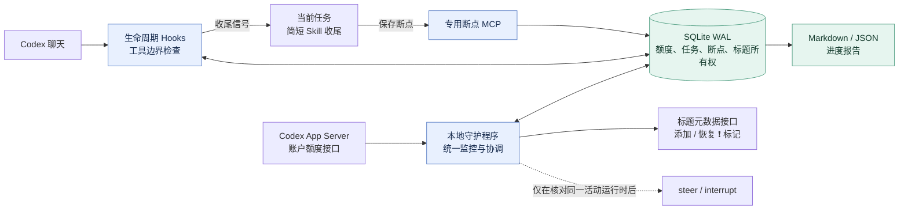

# fly-CodexLimit

[English](README.md) | **简体中文**

**在 Codex 额度耗尽前自动保存进度，让任务可以从断点继续。**

Python 3.11+ · 优先支持 Windows · 运行时仅使用标准库 · [MIT](LICENSE)

本地 Codex 额度保护器：提前让任务保存进度并收尾，为已暂停的聊天加 `❗ `，
额度恢复且用户实际续做后移除程序添加的标记。支持多个任务共用一份账户状态。
Python 3.11+，运行时没有第三方依赖；监控、改名和状态更新不调用模型。

**当前提供可运行的 Hooks 协作版本。** 本机已验证真实额度读取、会话元数据读取、
Windows Hook 命令、后台启动退出与隔离环境的完整暂停/恢复流程。
桌面版现有聊天的强制中断，仍要求接通承载它的同一运行时；独立新开的 App Server
无法接管桌面正在运行的回合。真实桌面界面对外部改名的刷新时机尚未实测。
详见 [兼容性记录](docs/COMPATIBILITY.md)。

## 设计架构



监控、改名和状态协调由普通程序执行；任务仅在保存语义断点时使用当前模型上下文。
Hooks 不逐个联网查额度，多个任务共享同一个守护程序的判断。

## 先看演示

在 PowerShell 中运行：

```powershell
git clone https://github.com/flyl1u/fly-CodexLimit.git
cd fly-CodexLimit
python guard.py demo
```

演示三个任务同时运行、统一保护、保存断点并加标记、额度恢复后等待用户、
逐个实际续做后恢复标题。使用模拟额度和内存运行时，Codex 连接数与模型请求数均为 0。
结果在 `.guard-local/demo/demo-run.json`，每次运行使用独立的演示状态目录。

## 启用到本机 Codex

前提是已安装 Python 3.11+，并通过 `codex login` 登录 Codex CLI。
首次安装按以下顺序启动监控，再安装会话集成：

```powershell
python guard.py doctor --live
python guard.py init
powershell.exe -NoProfile -File .\scripts\start-guard.ps1
python guard.py status
python guard.py install --dry-run
python guard.py install
```

安装器合并用户级 `hooks.json`，向 `config.toml` 加入专用断点 MCP，
安装 `codex-limit-checkpoint` Skill，保留其他已有配置。
随后在支持 `/hooks` 的 Codex CLI 中审核并信任这些 Hook 定义，重新打开要保护的聊天。
官方机制要求非托管 Hook 获得信任后才能运行；程序不会更改信任记录或绕过审核。
桌面版是否已经加载，以 `status --json` 中出现真实任务登记、工具事件和断点为准。
[官方 Hook 信任说明](https://learn.chatgpt.com/docs/hooks#review-and-trust-hooks)。

安装会同时配置 Hooks、专用 MCP 与收尾 Skill。请重新打开要保护的聊天，使新配置加载。
仅在安装或 Hook 定义变更后需要重新审核；日常监控不会反复要求信任。

只有完成安装、信任并加载 Hook 的会话才受保护。已经执行中的命令仍可能继续运行；
后台命令及结果应写入断点，恢复时先核实现场。

默认状态位于 `%USERPROFILE%\.codex\limit-guard`。支持 `CODEX_HOME`、
`CODEX_LIMIT_GUARD_HOME`，或在子命令前指定 `--home`。
自定义安装目标使用 `install --codex-home PATH`；监控程序会绑定该目标的账户配置。

## 平常怎么用

正常状态 Hook 只检查本地 SQLite，安静退出。会话开始时注入简短协议，
模型在重要里程碑使用 `codex_limit_guard.save_checkpoint` 保存进度。
进入保护后，Hook 拒绝新的业务操作，仍允许专用 MCP 保存/读取断点与查询状态，
然后让任务用当前上下文简短汇报并结束这一轮。

| 阶段 | 行为 |
| --- | --- |
| `running` | 任务执行中，重要阶段保存断点 |
| `pausing` | 已发出收尾信号，等待 Stop/Interrupt/同一运行时确认 |
| `paused` | 确认回合结束，准备添加标记，等待额度恢复 |
| `ready` | 新查询确认额度恢复，继续保留感叹号 |
| `resuming` | 用户消息已通过恢复排队，等待实际业务工具执行 |
| `running` / `idle` | 已实际续做，移除程序拥有的前缀；回合结束回到 idle |

`idle` 表示这一轮结束，不等于整个业务任务完成。不会自动回放用户消息或开启模型回合。
多个暂停任务同时请求续做时，按先后顺序和配置间隔放行；被 Hook 拦下的消息需要稍后重发。
如果续做只说了一段话、没有执行业务工具，标记继续保留。

```powershell
python guard.py status --json
python guard.py checkpoint --thread YOUR_THREAD_ID
python guard.py doctor --live --thread YOUR_THREAD_ID
```

断点报告保存在状态目录的 `checkpoints/` 下，包含 Markdown 和 JSON。
文件名由聊天 ID 的哈希生成，JSON 记录原聊天 ID。未能完成本次收尾时，
报告明确注明最近断点的原时间；没有断点时不会推测业务进度。

## 配置

`init` 创建状态目录中的 `config.json`。参考 [配置示例](examples/config.json)。
修改后重启守护程序；Hook 在下一次执行时读取新配置。

| 配置 | 默认值 | 用途 |
| --- | --- | --- |
| `warn_remaining` | 20 | 剩余比例到达预警线，阻止新回合及新的并行分支 |
| `pause_remaining` | 10 | 基础收尾线 |
| `resume_remaining` | 25 | 恢复滞回线，避免刚恢复就再次暂停 |
| `reserve_per_extra_task` | 2 | 每多一个并发任务增加的比例预算 |
| `max_pause_remaining` | 60 | 动态收尾线的上限 |
| `poll_seconds` | 30 | 账户轮询间隔；所有 Hook 共享结果 |
| `grace_seconds` | 90 | 发出保护信号后，运行时中断兜底的等待时间 |
| `stale_seconds` | 120 | 数据过期后按未知状态保护，不能视为额度充足 |
| `resume_spacing_seconds` | 15 | 不同任务恢复放行的最小间隔 |
| `resume_slot_seconds` | 120 | 恢复排队/等待首次执行的有效时间 |
| `limit_ids` | `[]` | 默认检查返回的所有额度桶；可限定确实相关的桶 |
| `control_active_turns` | `false` | 仅在可连接同一活动运行时的情况下启用中断控制 |

动态收尾线 = 基础收尾线 + 并发预算 + 最近消耗速度 ×（轮询间隔 + 收尾等待），
受上限约束。消耗速度取相邻查询中各窗口的最大增长率，不跨重置计算。
同时检查短期和长期窗口，最紧张的窗口决定保护；不会仅凭重置时间到了就恢复。
这些阈值是可调节的预算估计，无法保证所有任务恰好有足够的模型收尾额度。

`server_command` 默认为 `["codex", "app-server"]`。Windows npm 安装会安全解析到
Node 入口，不通过 shell 拼接命令。若有真正连接同一运行时的代理，可自行配置参数数组，
再启用 `control_active_turns`。程序逐次核对已加载任务、活动状态和回合 ID 后才 steer/interrupt；
不匹配时保留断点并报告能力不足，不会 resume 陌生会话。

## 后台、登录启动与卸载

调试时前台运行；`--once` 仅用于单次诊断，不提供持续保护：

```powershell
python guard.py daemon
python guard.py daemon --once
```

安装当前用户登录启动任务；它使用用户权限和隐藏窗口运行，不需要管理员权限：

```powershell
powershell.exe -NoProfile -File .\scripts\install-startup.ps1
```

停止并卸载：

```powershell
python guard.py stop
powershell.exe -NoProfile -File .\scripts\install-startup.ps1 -Remove
python guard.py uninstall
```

卸载仅移除安装记录中匹配的配置，保留其他 Hook、MCP 和手动修改的 Skill。
断点、SQLite 和原配置备份保留在状态目录，便于恢复。若托管配置块被手动更改，
程序会说明冲突并保留现场，不用旧备份覆盖当前配置。

## 开发验证

```powershell
python -W error::ResourceWarning -m unittest discover -v
python -m compileall -q codex_limit_guard guard.py
python -m pip wheel . --no-deps --wheel-dir .guard-local/dist
```

46 项测试覆盖额度窗口、滞回、并发写入、数据库升级、恢复排队、工具准入、
真实 Windows Hook 命令、MCP 协议、标题所有权、RPC 断线/超时、安装回滚和卸载合并。
真实账户验证只调用只读接口，不启动模型回合，不修改真实聊天标题。

实现步骤和提交约定见 [PLAN.md](PLAN.md)，数据与接口约束见 [架构说明](docs/ARCHITECTURE.md)。
源码更改按独立阶段提交 Git。远程仓库为 [flyl1u/fly-CodexLimit](https://github.com/flyl1u/fly-CodexLimit)。

## 许可证

[MIT](LICENSE)，版权声明见 LICENSE。
