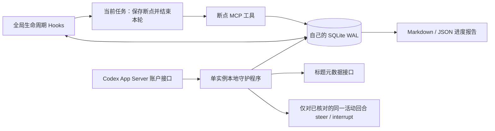

# 架构与状态约束

## 模块

- `policy.py`：解析额度窗口和计算收尾预算；纯函数，不进行网络或磁盘操作。
- `store.py`：SQLite 事务协调、恢复队列和数据库迁移。
- `rpc.py`：独立 JSONL 客户端，握手、通知、超时、断线与进程退出。
- `daemon.py`：查询完整账户快照、协调收尾、标题和断点导出。
- `hooks.py`：从真实生命周期事件登记任务、检查缓存并返回官方 Hook JSON。
- `mcp_server.py`：提供 save_checkpoint / read_checkpoint / status，无 shell 执行入口。
- `install.py`：精确合并用户配置，用文件事务日志回滚中断的安装。
- `skill/SKILL.md`：仅在保护与续做时需要的简短语义收尾规则。

## 并发与持久化

SQLite 采用 WAL，写入使用 `BEGIN IMMEDIATE`，每次操作释放连接。
多个进程执行 Hook 不依赖进程内锁。守护程序独占有过期时间的租约，
独立心跳续期，重连使用退避；同一状态目录不允许两个协调器同时启动。
`stop` 通过本地状态通知进程退出，不根据一个过期 PID 杀进程。

只管理通过本套 Hook 登记的聊天，不扫描后自动更改用户的所有会话。
默认不解析 Codex 的不稳定会话转录格式，也不读写 Codex 私有 SQLite 或 auth.json。
安装备份会保存本机原 config.toml/hooks.json，不进入源码仓库。

相同回合的 Stop/Interrupt/运行时结束通知幂等。旧回合的断点、工具结果和完成通知
不会覆盖已经恢复的新回合。子代理工具 Hook 可能使用父会话 ID，
不同 turn_id 的正常工具事件不覆盖父任务；本版不对每个子代理单独管理标题。

## 结束和中断

进入保护只表示请求收尾，阶段为 `pausing`。未收到确认时不能声称回合已结束，
报告会写明“等待回合结束确认”。独立运行时中的 `notLoaded` 不能作为桌面回合结束证据。
仅当同一连接的 loaded/list 和 thread/read 同时确认相同活动回合，
且配置显式允许时才 steer/interrupt。

中断请求成功也不是结束确认；继续等待 Hook 或终态通知。
Stop 时若仍无本次暂停后的断点，注入完整收尾 Skill，最多请求一次当前回合续写。
续写已执行、断点已保存或用户主动中断时直接结束，不循环要求模型补写。
额度恢复后，新的 UserPromptSubmit 回合 ID 可以确认旧回合已被取代，恢复缺少结束 Hook 的任务；
普通工具或子代理携带的不同回合 ID 不具备这个权限。
没有获得新的语义断点时，导出旧记录及其时间，或明确说明尚无断点。
工具执行事件只记录名称和时间，不保存完整命令参数、输出或用户提示文本。

## 标题所有权

改名通过 thread/name/set，不发起模型请求。先保存变更意图，再调用接口，
成功后确认；中途崩溃可根据当前标题判断之前是否已经写入。
已有相同感叹号的用户标题不归程序所有。恢复只移除自己拥有的一次前缀，
保留前缀后的手动编辑；手动去掉前缀也会保留。
前缀按暂停时的配置持久保存，修改配置不会误删不同标记。

## 低额度和故障

未知、缺失、过期的数据既不证明额度充足，也不构成暂停证据。监控故障时继续业务，
明确保持 unknown，并解除未经有效快照支持的暂停。有效数据确认恢复后仍保留
真实额度锁定的滞回策略。额度恢复与任务实际恢复是两个状态，默认不启动新回合。
高于保护线时安静放行业务操作。默认固定使用五小时 5%、周额度 2% 收尾线，
动态预算须显式设置 adaptive_reserve=true。保护及恢复排队期间仍接收用户消息，
分别注入收尾 Skill 或等待原因；恢复票据控制业务执行，不后台回放消息。
缓存故障保留已有的真实额度锁定，但不会新增锁定。保护策略变更后根据新快照重新判断。

保护期间只开放精确匹配的本程序 MCP 工具。保存/读取断点时还核对当前 session_id；
不会因为 shell 命令包含 checkpoint 字样而放过整段命令。
Hook 检查故障返回空结果，不以监控错误拒绝工具或注入收尾信号。
`disabled.json` 是独立于额度、配置解析和数据库的持久停用开关。
专用 disable_guard MCP 在保护时也放行；卸载后缓存的 Hook 在入口直接退出。
MCP/用户回合可后台恢复退出的监控；SQLite 启动预留和进程租约防止重复启动，
Windows 只读查询进程存活，不以 os.kill(pid,0) 探测。显式停用和卸载禁止自动恢复。
Codex 本身的 Hook 超时、未信任或不支持的工具路径
仍有官方覆盖边界，因此这不是对模型一切活动的强制执行沙箱。

官方依据：
[Hook 输入输出与覆盖范围](https://learn.chatgpt.com/docs/hooks)、
[App Server 握手和账户/回合接口](https://learn.chatgpt.com/docs/app-server)。
